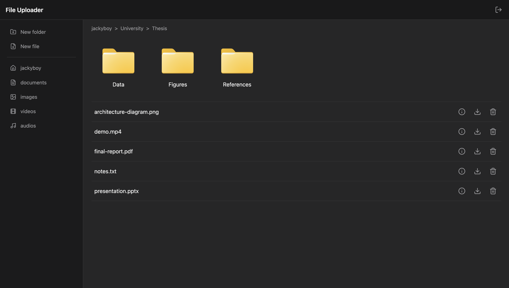

# File Uploader

A file storage app where users can sign up, organize their files in nested folders, upload files to the cloud and download them.

🔗 [Live Demo](https://file-uploader-kvtl.onrender.com)

## Features

- Sign up and log in with persistent sessions (Passport.js + express-session, stored in PostgreSQL)
- Default system folders for every user: documents, images, videos and audios
- Create, rename and delete folders, nested as deep as needed
- Breadcrumb navigation through the folder tree
- Upload files up to 10 MB, checked in the browser and enforced on the server
- File details: size, upload date and type
- Download files with their original name

## How files are stored

Files are uploaded to Cloudinary as **private** assets, and the database only stores their key, never a public URL.

To download a file, the server checks that it belongs to the logged-in user, creates a **signed URL** valid for 60 seconds, fetches the file with it and streams it back to the browser. The browser never sees a Cloudinary URL, so files can't be shared or guessed, and every download goes through the app's access check.

## Built with

- Node.js
- Express
- PostgreSQL (Neon)
- Prisma
- Passport.js (passport-local)
- express-session + Prisma Session Store
- bcryptjs
- Multer
- Cloudinary
- EJS
- CSS
